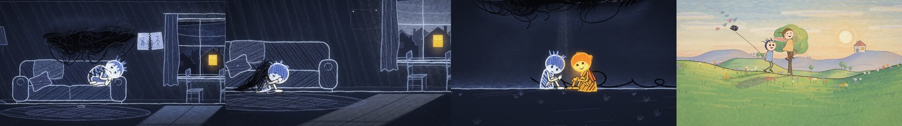

<p align="center">
  
</p>

<h1 align="center">atelier</h1>

<p align="center">
  <em>A workshop for things made with agents: films, articles, and what comes next.</em>
</p>

<p align="center">
  <a href="CHANGELOG.md"></a>
  <a href="https://www.python.org"></a>
  <a href="https://github.com/kyamagu/skia-python"></a>
  
</p>

<p align="center">
  <strong>English</strong> · <a href="README.zh-CN.md">中文</a>
</p>

> [!WARNING]
> This repository holds third-party recordings and lyric files as reference
> material. Keep it private.

Every work here is source, not footage: the code that draws it, the notes that
decide it, and the material it answers to. A film renders again from this
repository, frame for frame; the videos themselves are not stored.

## Works

<table>
  <tr>
    <td width="34%"></td>
    <td>
      <b>《好想爱这个世界啊》</b> · 华晨宇 · music film, 4:19<br>
      A child living with depression, told as the child's own chalk drawing on
      dark paper: one continuous drawing with no cuts, timed to the studio
      recording. Gloom is a black scribble; a friend, colour and the open
      evening come back in steps.<br>
      <sub><code>hx/</code> (version 4, code-drawn) · <code>gx/</code> (anime cut, reference) ·
      <a href="docs/works/haoxiang.md">work page</a></sub>
    </td>
  </tr>
</table>

## How a film is made

- **Materials first.** The recording and its time-stamped lyrics are fetched
  into `reference/<work>/`, then measured once into a timeline: sections, line
  stamps, beats and attacks (`hx/data/timeline.json`).
- **Story tied to the lyrics.** Each line gets an image, addressed by line
  index and time ([storyboard](hx/STORYBOARD.md)).
- **Drawn by code.** skia and numpy draw every pixel; figures act on a pose
  rig; a frame is a pure function of the recording's time.
- **Rendered in chunks.** Worker processes pipe raw frames into ffmpeg; the
  recording is muxed untouched from time zero.

## Get started

```bash
python3.14 -m venv .venv && .venv/bin/pip install -r requirements.txt
.venv/bin/python -m hx.still --t 230 --scale 0.5 --out hx/_review/x.jpg     # one frame
.venv/bin/python -m hx.render --out output/haoxiang-mv.mp4 --audio           # the whole film, final quality
```

Add `--draft` for a 960x540 preview, `--t0`/`--t1` for a slice, and
`--lyrics reference/haoxiangaizhegeshijie/haoxiangaizhegeshijie.lrc` to burn
in the lyric lines.

## Documentation

| | |
| --- | --- |
| **Works** | [《好想爱这个世界啊》](docs/works/haoxiang.md) |
| **hx film** | [Design](hx/DESIGN.md) · [Storyboard](hx/STORYBOARD.md) · [Chalk kit](hx/chalk/README.md) · [Scene guide](hx/scenes/README.md) |
| **Shared code** | [`mv/engine`](mv/engine/__init__.py) colour and primitives · [`mv/encode.py`](mv/encode.py) encoding |

All pages: [docs index](docs/README.md).

## Contributing

Rules for people and agents (creative contracts, code style, verification,
how to work with agents) are in [AGENTS.md](AGENTS.md).

## License

All rights reserved. The recordings and lyrics under `reference/` belong to
their rights holders and are kept here for private reference only.
