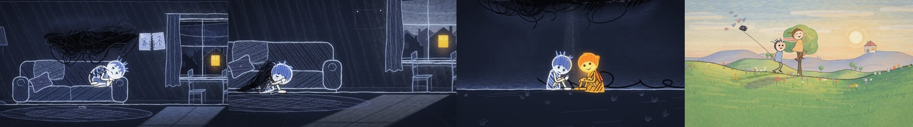

<p align="center">
  
</p>

<h1 align="center">atelier</h1>

<p align="center">
  <em>用智能体创作的工作室：影片、文章，以及之后的一切。</em>
</p>

<p align="center">
  <a href="CHANGELOG.md"></a>
  <a href="https://www.python.org"></a>
  <a href="https://github.com/kyamagu/skia-python"></a>
  
</p>

<p align="center">
  <a href="README.md">English</a> · <strong>中文</strong>
</p>

> [!WARNING]
> 本仓库存有第三方的录音和歌词文件作为参考资料，请保持私有。

这里存的每件作品都是源头而不是成片：画出它的代码、决定它的设计笔记，以及它所回应的素材。影片可以从本仓库逐帧重新渲染出来，视频本身不入库。

## 作品

<table>
  <tr>
    <td width="34%"></td>
    <td>
      <b>《好想爱这个世界啊》</b> · 华晨宇 · 音乐影片，4 分 19 秒<br>
      一个患抑郁症的孩子的故事，画成孩子自己在深色纸上的粉笔画：一镜到底、没有剪切，
      完全踩着录音室版的时间轴。阴霾是一团黑色涂鸦；朋友、颜色和开阔的傍晚一步步回来。<br>
      <sub><code>hx/</code>（第 4 版，代码绘制）· <code>gx/</code>（动漫生成版，仅作参考）·
      <a href="docs/works/haoxiang.md">作品页</a></sub>
    </td>
  </tr>
</table>

## 一部影片怎么做出来

- **先备齐素材。** 录音和带时间轴的歌词下载到 `reference/<作品>/`，然后测量一次，得到时间线：段落、每句歌词的时间点、拍子和起音（`hx/data/timeline.json`）。
- **故事贴着歌词。** 每一句歌词都有对应的画面，用行号和时间来指代（[分镜](hx/STORYBOARD.md)）。
- **全部由代码绘制。** skia 和 numpy 画出每一个像素；人物在姿态骨架上表演；每一帧都只取决于录音的时间。
- **分块渲染。** 多个进程把原始帧送进 ffmpeg 编码；录音原样从 0 秒开始合入。

## 快速开始

```bash
python3.14 -m venv .venv && .venv/bin/pip install -r requirements.txt
.venv/bin/python -m hx.still --t 230 --scale 0.5 --out hx/_review/x.jpg     # 渲染一帧
.venv/bin/python -m hx.render --out output/haoxiang-mv.mp4 --audio           # 整片，最终画质
```

加 `--draft` 出 960x540 预览，`--t0`/`--t1` 只渲染一段，加 `--lyrics reference/haoxiangaizhegeshijie/haoxiangaizhegeshijie.lrc` 把歌词烧进画面。

## 文档

| | |
| --- | --- |
| **作品** | [《好想爱这个世界啊》](docs/works/haoxiang.md) |
| **hx 影片** | [设计](hx/DESIGN.md) · [分镜](hx/STORYBOARD.md) · [粉笔工具包](hx/chalk/README.md) · [场景编写指南](hx/scenes/README.md) |
| **共享代码** | [`mv/engine`](mv/engine/__init__.py) 颜色与绘图基础 · [`mv/encode.py`](mv/encode.py) 编码 |

全部页面见[文档索引](docs/README.md)。

## 参与

给人和智能体的规则（创作约定、代码风格、验证方式、如何使用智能体）在 [AGENTS.md](AGENTS.md)。

## 版权

保留所有权利。`reference/` 下的录音和歌词归其权利人所有，仅作私人参考保存于此。
